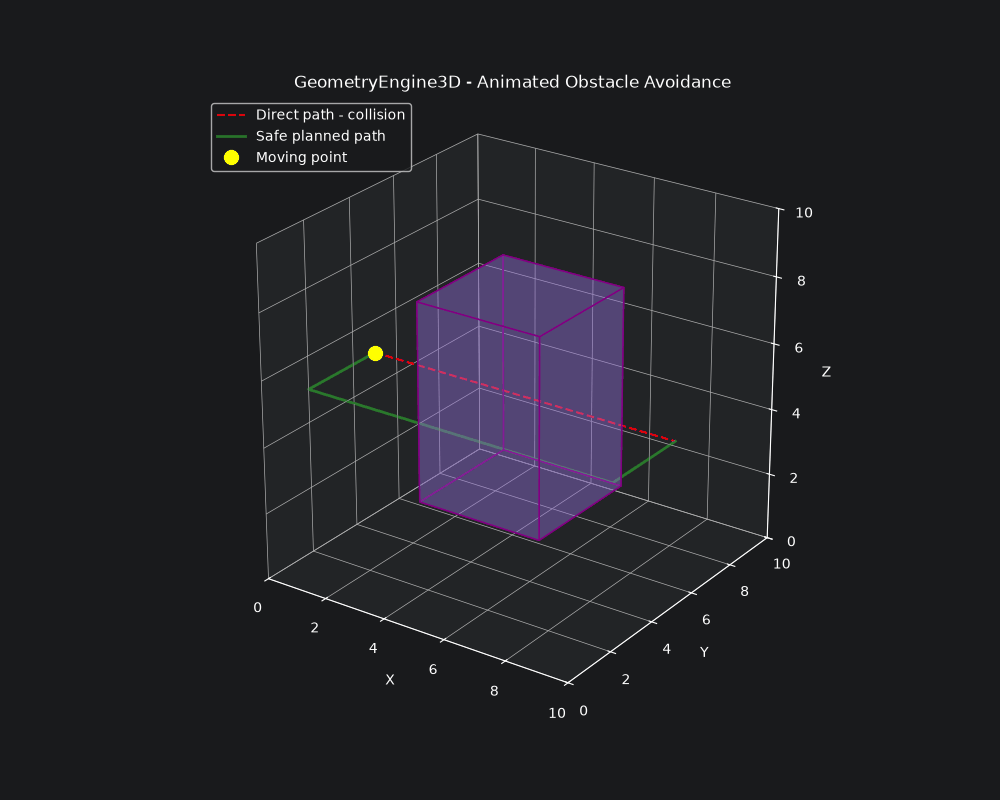

# GeometryEngine3D

**3D Motion Planning, Collision Detection, and Obstacle Avoidance**

GeometryEngine3D is a Python project for mathematical modeling, trajectory planning, and collision detection in three-dimensional space.

The project's practical goal is to calculate a path between two points, detect whether it intersects a solid obstacle, and generate and visualize an alternative collision-free route. It combines Euclidean geometry, vector algebra, analytic geometry, numerical experiments, automated tests, and Jupyter Notebook visualizations.

The current motion-planning demonstration models a moving **point** and one **axis-aligned rectangular solid**. It is a geometric simulation, not a physical vehicle controller.

## 1. Project Objectives

- Represent points, vectors, lines, triangles, planes, and rectangular solids in 3D.
- Perform geometric calculations and transformations.
- Construct linear and multipoint trajectories using parametric equations.
- Detect intersections and first contact points between trajectories and solid obstacles.
- Generate and verify collision-free candidate routes.
- Compare the lengths of direct and planned paths.
- Visualize geometric objects and animate movement in 3D.
- Validate implementations using automated tests.

## 2. Mathematical Models and Implemented Features

### 2.1 Point3D

A point in Cartesian space is represented by $P=(x,y,z)$. The `Point3D` class supports distance calculation, translation, and scaling.

$$
d(A,B)=\sqrt{(x_2-x_1)^2+(y_2-y_1)^2+(z_2-z_1)^2}
$$

### 2.2 Vector3D

The `Vector3D` class supports vector magnitude, addition, subtraction, dot product, and cross product.

$$
|\vec v|=\sqrt{x^2+y^2+z^2}
$$

$$
\vec a\cdot\vec b=a_xb_x+a_yb_y+a_zb_z
$$

### 2.3 Trajectory3D

`Trajectory3D` models a point's position with a parametric equation:

$$
\mathbf r(t)=(t^2,2t,\sin t)
$$

### 2.4 Line3D

`Line3D` represents a line using a point and direction vector:

$$
\mathbf r(t)=P_0+t\vec v
$$

### 2.5 Triangle3D

`Triangle3D` calculates side lengths, perimeter, and area. The area of a triangle with vertices $A,B,C$ is:

$$
S=\frac12\left|(\vec B-\vec A)\times(\vec C-\vec A)\right|
$$

### 2.6 Plane3D

`Plane3D` supports plane representation, point membership, point-to-plane distance, and line-plane intersections. A plane can be written as:

$$
ax+by+cz+d=0
$$

### 2.7 LinearPath3D

`LinearPath3D` interpolates between two points:

$$
P(t)=(1-t)P_0+tP_1,\qquad 0\leq t\leq1
$$

### 2.8 MultiPointPath3D

`MultiPointPath3D` constructs a continuous piecewise linear trajectory through multiple control points:

$$
P_0\rightarrow P_1\rightarrow\cdots\rightarrow P_n
$$

Each segment receives an equal interval of the global interpolation parameter.

### 2.9 Box3D

`Box3D` models an axis-aligned rectangular solid defined by two opposite corners:

$$
P_{\min}=(x_{\min},y_{\min},z_{\min}),\qquad
P_{\max}=(x_{\max},y_{\max},z_{\max})
$$

It supports dimension validation, volume, surface area, point containment, segment intersection, and first contact point calculations.

For side lengths $a,b,c$:

$$
V=abc,\qquad S=2(ab+ac+bc)
$$

For corners $(3,3,2)$ and $(7,7,8)$, the dimensions are $(4,4,6)$, the volume is $96$, and the surface area is $128$.

### 2.10 Collision Detection

The project detects intersections between a line segment and an axis-aligned rectangular solid using the slab intersection method. A segment is represented as:

$$
P(t)=A+t(B-A),\qquad 0\leq t\leq1
$$

- `Box3D.intersects_segment()` checks intersection or contact with a box.
- `Box3D.first_contact()` calculates the first contact point.
- `path_has_collision()` checks all consecutive segments of a multipoint path.

A path is considered colliding if any of its segments intersects or touches the obstacle.

### 2.11 Automatic Path Planning

`plan_path()` attempts to find a route around one rectangular obstacle:

1. Check the direct path for a collision.
2. If the direct path is clear, return it.
3. Otherwise, generate alternative candidate routes using a specified clearance.
4. Reject candidates that collide with the obstacle.
5. Select the shortest among the remaining candidates.

**Limitation:** This is a candidate-based planner for one axis-aligned box. It does **not** guarantee a globally shortest route, and it may fail to find a path even if another valid route exists.

## 3. Project Structure

```text
GeometryEngine3D/
├── docs/
│   └── geometry3d_obstacle_avoidance.gif
├── notebooks/
│   ├── 01_points_and_vectors.ipynb
│   ├── 02_lines_and_triangles.ipynb
│   ├── 03_planes_and_transformations.ipynb
│   └── 04_trajectory_planning.ipynb
├── src/
│   └── geometry_engine/
│       ├── point.py
│       ├── vector.py
│       ├── trajectory.py
│       ├── line.py
│       ├── triangle.py
│       ├── plane.py
│       ├── path.py
│       ├── multipoint_path.py
│       ├── box.py
│       ├── collision.py
│       └── path_planner.py
├── tests/
│   ├── test_point.py
│   ├── test_vector.py
│   ├── test_trajectory.py
│   ├── test_line.py
│   ├── test_triangle.py
│   ├── test_plane.py
│   ├── test_path.py
│   ├── test_multipoint_path.py
│   ├── test_box.py
│   ├── test_collision.py
│   └── test_path_planner.py
├── .gitignore
├── pyproject.toml
├── requirements.txt
└── README.md
```

## 4. Jupyter Notebooks

| Notebook | Content |
|---|---|
| [01 — Points and Vectors](notebooks/01_points_and_vectors.ipynb) | Points, vectors, and Euclidean geometry |
| [02 — Lines and Triangles](notebooks/02_lines_and_triangles.ipynb) | Lines, triangles, and geometric calculations |
| [03 — Planes and Transformations](notebooks/03_planes_and_transformations.ipynb) | Planes and geometric transformations |
| [04 — Trajectory Planning](notebooks/04_trajectory_planning.ipynb) | Multipoint paths, collision detection, automatic obstacle avoidance, 3D visualization, and animation |

## 5. Multipoint Trajectory Experiment

A trajectory passes through four control points:

$$
P_0=(0,0,0),\quad P_1=(6,0,0),\quad P_2=(6,8,0),\quad P_3=(6,8,10)
$$

The total length is:

$$
L=\sum_{i=0}^{n-1}\|P_{i+1}-P_i\|=6+8+10=24
$$

### 5.1 Speed Analysis

With equal parameter intervals and an assumed total travel time of one second, each of the three segments takes $\Delta t=1/3$ second.

$$
v_i=\frac{L_i}{\Delta t}
$$

| Segment | Length | Speed (units/s) |
|---|---:|---:|
| P0 → P1 | 6 | 18 |
| P1 → P2 | 8 | 24 |
| P2 → P3 | 10 | 30 |

Equal time intervals do not guarantee constant speed when segment lengths differ.

## 6. 3D Collision Detection Experiment

Consider a direct trajectory from $A=(0,5,5)$ to $B=(10,5,5)$:

$$
P(t)=(10t,5,5),\qquad 0\leq t\leq1
$$

The obstacle occupies:

$$
3\leq x\leq7,\qquad 3\leq y\leq7,\qquad 2\leq z\leq8
$$

The program calculates:

```text
Collision detected: True
First contact point: Point3D(x=3.0, y=5.0, z=5.0)
```

Thus the first contact occurs at $P_{\text{contact}}=(3,5,5)$.

## 7. Automatic Obstacle Avoidance Experiment

For the same start, goal, and obstacle, the planner generates:

| Point | Coordinates |
|---|---|
| P0 | (0, 5, 5) |
| P1 | (0, 2, 5) |
| P2 | (10, 2, 5) |
| P3 | (10, 5, 5) |

The middle segment lies on $y=2$, one unit away from the box's minimum $y$ boundary. The path collision checker returns `False`.

### 7.1 Path Length Comparison

$$
L_{\text{direct}}=10
$$

$$
L_{\text{planned}}=3+10+3=16
$$

$$
\text{Additional distance}=\frac{16-10}{10}\cdot100\%=60\%
$$

| Property | Direct Path | Planned Path |
|---|---:|---:|
| Path length | 10 | 16 |
| Collision detected | Yes | No |
| Number of segments | 1 | 3 |

The generated route is 60% longer but avoids the obstacle. This demonstrates the trade-off between travel distance and collision avoidance; it does not establish global optimality.

## 8. 3D Visualization and Animation

The fourth notebook visualizes a solid obstacle, a direct colliding path, a planned collision-free path, the first contact point, and start and goal positions.

### 8.1 Animated Demonstration



The animation samples the planned path at equal distance intervals and shows a point moving along it. This is a geometric animation rather than a physical simulation of acceleration, forces, or vehicle dynamics.

See [Notebook 04 — Trajectory Planning](notebooks/04_trajectory_planning.ipynb) for the calculations, plots, and animation code.

## 9. Automated Testing

The project uses `pytest` to verify geometric operations, path interpolation, solid geometry, segment-box intersections, contact detection, multipoint collision checks, and automatic path planning.

Run from the project root:

```bash
python -m pytest -q
```

Latest locally verified result (24 October 2026):

```text
78 passed in 0.17s
```

## 10. Installation and Usage

Python 3.12 or newer is required.

```bash
git clone https://github.com/TodorYankov/GeometryEngine3D.git
cd GeometryEngine3D
python -m venv .venv
```

Activate on Windows PowerShell:

```powershell
.\.venv\Scripts\Activate.ps1
```

Install the project and test dependencies:

```bash
python -m pip install -e .
python -m pip install -r requirements.txt
```

For notebooks, plotting, and GIF export:

```bash
python -m pip install jupyter matplotlib numpy pillow
```

### 10.1 Multipoint Trajectory Example

```python
from geometry_engine.point import Point3D
from geometry_engine.multipoint_path import MultiPointPath3D

points = (
    Point3D(0, 0, 0),
    Point3D(6, 0, 0),
    Point3D(6, 8, 0),
    Point3D(6, 8, 10),
)

path = MultiPointPath3D(points)
position = path.position(0.5)
print(position)
```

Expected coordinates: `(6.0, 4.0, 0.0)`.

### 10.2 Automatic Obstacle Avoidance Example

```python
from geometry_engine.point import Point3D
from geometry_engine.box import Box3D
from geometry_engine.collision import path_has_collision
from geometry_engine.path_planner import plan_path

obstacle = Box3D(Point3D(3, 3, 2), Point3D(7, 7, 8))
start = Point3D(0, 5, 5)
goal = Point3D(10, 5, 5)

safe_path = plan_path(start, goal, obstacle, clearance=1.0)

for point in safe_path:
    print(point)

print("Collision detected:", path_has_collision(safe_path, obstacle))
```

Expected final line:

```text
Collision detected: False
```

## 11. Methodology

1. Define a geometric problem and its assumptions.
2. Express the problem using mathematical models.
3. Implement the algorithms in Python.
4. Construct tests with known results and boundary cases.
5. Compare computed results with expectations.
6. Visualize experiments in Jupyter Notebooks.
7. Analyze results, trade-offs, and limitations.

The main experiment investigates whether a piecewise linear route can be generated to connect two points without intersecting a rectangular solid.

## 12. Limitations

- Obstacles are axis-aligned rectangular solids.
- The planner handles one obstacle at a time.
- Generated routes consist of straight segments.
- The planner does not guarantee globally optimal routes or completeness.
- The moving object is treated as a point without physical dimensions.
- Forces, acceleration, turning constraints, and vehicle dynamics are not modeled.
- The current simulation does not model transitions between air, water, and other physical media.

## 13. Conclusions

GeometryEngine3D demonstrates how three-dimensional geometry can support a practical motion-planning task. In the worked example, a direct path of length 10 intersects a solid obstacle, while an automatically generated path of length 16 avoids it. The calculation is verified by collision tests and illustrated through 3D visualization and animation.

The project connects mathematical definitions with implemented algorithms, automated verification, and a concrete experimental result.

## 14. References

1. **Weisstein, Eric W.**  
   *MathWorld — A Wolfram Web Resource.*  
   https://mathworld.wolfram.com/  
   Mathematical reference for Euclidean geometry, vectors,
   planes, and three-dimensional solids.

2. **Ericson, Christer. (2005).**  
   *Real-Time Collision Detection.* Morgan Kaufmann.  
   https://realtimecollisiondetection.net/  
   Reference for geometric intersection tests,
   bounding volumes, and collision detection.

3. **LaValle, Steven M. (2006).**  
   *Planning Algorithms.* Cambridge University Press.  
   https://lavalle.pl/planning/  
   Reference for motion planning, path planning,
   and obstacle avoidance.

4. **Python Software Foundation.**  
   *Python 3 Documentation.*  
   https://docs.python.org/3/

5. **Matplotlib Development Team.**  
   *Matplotlib Documentation.*  
   https://matplotlib.org/stable/

6. **NumPy Developers.**  
   *NumPy Documentation.*  
   https://numpy.org/doc/stable/

7. **pytest Development Team.**  
   *pytest Documentation.*  
   https://docs.pytest.org/
## 15. Author

**Todor Yankov**

Math Concepts for Developers — SoftUni, September 2026

GitHub: https://github.com/TodorYankov/GeometryEngine3D
